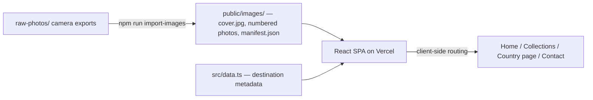

<div align="center">

# Jared Mananguit — Photography Portfolio

**Let the photographs tell the story.**

A travel and street photography portfolio, built to feel like opening a photography book rather than browsing a website. Editorial layout, restrained typography, and an interface that quietly gets out of the way.


-000000?logo=vercel&logoColor=white)

[Repository](https://github.com/Jrddlol2/jnmananguit) · [Documentation](#-documentation) · [Roadmap](docs/ROADMAP.md)

</div>

---

## Table of Contents

- [Vision](#vision)
- [Screenshots](#screenshots)
- [Website Structure](#website-structure)
- [Collections](#collections)
- [Tech Stack](#tech-stack)
- [Quick Architecture](#quick-architecture)
- [Getting Started](#getting-started)
- [Available Commands](#available-commands)
- [Deployment](#deployment)
- [Maintenance Quick Reference](#maintenance-quick-reference)
- [📖 Documentation](#-documentation)
- [Contributing](#contributing)

## Vision

This project exists to show photographs, not to demonstrate a web framework. The design philosophy — and the reasoning behind every "no" (no glassmorphism, no bright colors, no flashy motion) — is written out in full in **[docs/DESIGN.md](docs/DESIGN.md)**. The short version:

> Photography always comes first. The interface should quietly support the images without competing for attention.

Visual direction is informed by photographers like Teo Crawford and Peter McKinnon — editorial minimalism, full-bleed imagery, generous whitespace — as a style compass, not a template to copy.

## Screenshots

<details>
<summary><strong>Homepage</strong></summary>
<br>

`docs/screenshots/home.png` — *placeholder, add a screenshot here*

Full-bleed hero (responsive focal point per device, see `src/data/hero.ts`) over a destination card grid.
</details>

<details>
<summary><strong>Collections</strong></summary>
<br>

`docs/screenshots/collections.png` — *placeholder*

All destinations, same card grid component as the homepage.
</details>

<details>
<summary><strong>Country Page</strong></summary>
<br>

`docs/screenshots/country.png` — *placeholder*

Full-bleed cover banner, description, masonry photo grid, full-screen lightbox on click.
</details>

<details>
<summary><strong>Gear</strong></summary>
<br>

`docs/screenshots/gear.png` — *placeholder*

Currently a "Coming Soon" placeholder page. See [docs/GEAR_SYSTEM.md](docs/GEAR_SYSTEM.md) for the design spec.
</details>

<details>
<summary><strong>Contact</strong></summary>
<br>

`docs/screenshots/contact.png` — *placeholder*
</details>

<details>
<summary><strong>404</strong></summary>
<br>

`docs/screenshots/404.png` — *placeholder*
</details>

## Website Structure

| Section | Route | Purpose | Status |
|---|---|---|---|
| **Home** | `/` | Full-bleed hero + featured destinations grid — the first impression | ✅ Live |
| **Collections** | `/collections` | Every destination, same card grid as the homepage | ✅ Live |
| **Country page** | `/collections/:id` | One destination's cover banner, description, and full photo gallery | ✅ Live |
| **Gear** | `/gear` | Camera/lens archive | 🚧 Placeholder — see [GEAR_SYSTEM.md](docs/GEAR_SYSTEM.md) |
| **Film** | *(none yet)* | Film stock archive | 📋 Designed, not built — see [FILM_SYSTEM.md](docs/FILM_SYSTEM.md) |
| **Contact** | `/contact` | Email + social links | ✅ Live |
| **About** | *(removed)* | — | Intentionally removed; see note in [ROADMAP.md](docs/ROADMAP.md) if reviving it |
| **404** | `*` | Catch-all for invalid routes | ✅ Live |

Design intent and future expansion possibilities for each section are covered in [docs/ARCHITECTURE.md](docs/ARCHITECTURE.md#routing) (structure) and [docs/ROADMAP.md](docs/ROADMAP.md) (what's next).

## Collections

| Country | Photos |
|---|---|
| Japan | 52 |
| Taiwan | 52 |
| Bali | 25 |
| Thailand | 28 |

Collections are designed to be added without touching more than a couple of lines of code — see [docs/COLLECTIONS.md](docs/COLLECTIONS.md) for exactly how, and [docs/IMAGE_PIPELINE.md](docs/IMAGE_PIPELINE.md) for how raw camera exports become a published gallery.

## Tech Stack

| | |
|---|---|
| **Framework** | Vite + React 19 + TypeScript |
| **Routing** | React Router v7 |
| **Styling** | Tailwind CSS v4 |
| **Animation** | Motion (Framer Motion) |
| **Icons** | Lucide |
| **Image processing** | sharp (build-time, in the import pipeline) |
| **Package manager** | npm |
| **Hosting** | Vercel (static) |

Full rationale for each choice — including *why Vite instead of Next.js*, which earlier planning docs assumed — is in **[docs/ARCHITECTURE.md](docs/ARCHITECTURE.md)**.

## Quick Architecture



Full system diagram, data flow, and component tree: **[docs/ARCHITECTURE.md](docs/ARCHITECTURE.md)**.

## Getting Started

Prerequisites: Node.js 20+.

```bash
npm install
npm run dev
```

Runs at `http://localhost:3000`.

## Available Commands

| Command | What it does |
|---|---|
| `npm run dev` | Start the local dev server |
| `npm run build` | Production build to `dist/` |
| `npm run preview` | Serve the production build locally |
| `npm run lint` | TypeScript typecheck (`tsc --noEmit`) — the project's full static-analysis check |
| `npm run import-images` | Run the photo import pipeline for every country in `raw-photos/` |
| `npm run import-images -- japan` | Run it for just one (or space-separated several) |

## Deployment

Deploys to **Vercel** as a static site.

1. Push to GitHub.
2. Vercel → **Add New Project** → import the repo. Build command (`npm run build`) and output directory (`dist`) are pinned explicitly in [`vercel.json`](vercel.json), so this doesn't depend on auto-detection.
3. Deploy — **no environment variables are required.** This is a fully static site.
4. Once you have a live URL, update it in `src/lib/seo.ts` (`SITE_URL`), `public/robots.txt`, `public/sitemap.xml`, and the static tags in `index.html`, then redeploy.

`vercel.json` also carries the one piece of config a client-routed SPA actually needs on static hosting: a rewrite so every path serves `index.html` (otherwise a direct link to `/collections/japan` 404s on Vercel's static file server before React Router ever gets a chance to handle it).

<details>
<summary><strong>Production checklist</strong></summary>
<br>

- [ ] `npm run lint` and `npm run build` both pass locally
- [ ] `SITE_URL` updated in `src/lib/seo.ts`, `robots.txt`, `sitemap.xml`, and `index.html`
- [ ] Real photos are in place — placeholders degrade gracefully but shouldn't ship
- [ ] Share a link on Slack/Twitter/iMessage and confirm the `og-image.jpg` preview looks right
- [ ] Spot-check the deployed URL on an actual phone, not just desktop devtools

</details>

## Maintenance Quick Reference

| I want to... | Do this | Details |
|---|---|---|
| Add a new country | `raw-photos/<id>/` + one entry in `src/data.ts` + `npm run import-images -- <id>` | [COLLECTIONS.md](docs/COLLECTIONS.md) |
| Add/replace photos for a country | Drop files in `raw-photos/<id>/`, run the pipeline | [IMAGE_PIPELINE.md](docs/IMAGE_PIPELINE.md) |
| Force a specific cover photo | Add `COVER.txt` in that country's `raw-photos/` folder | [IMAGE_PIPELINE.md](docs/IMAGE_PIPELINE.md#cover-selection-algorithm) |
| Update page titles/descriptions | `useSEO({...})` call in the relevant `src/pages/*.tsx` | [ARCHITECTURE.md](docs/ARCHITECTURE.md#data-flow) |
| Add/change a social link | Edit `src/data/socials.ts` — one array, every usage renders from it | [STYLE_GUIDE.md](docs/STYLE_GUIDE.md#data-files) |
| Adjust the hero's mobile/desktop crop | `src/data/hero.ts` | — |

## 📖 Documentation

This README is the front door. Deep dives live in `docs/`:

| Document | Covers |
|---|---|
| [ARCHITECTURE.md](docs/ARCHITECTURE.md) | Tech stack + rationale, routing, data flow, component tree, build/deploy |
| [DESIGN.md](docs/DESIGN.md) | Visual philosophy, typography, color, motion, what's deliberately absent |
| [PROJECT_STRUCTURE.md](docs/PROJECT_STRUCTURE.md) | Full annotated directory tree |
| [IMAGE_PIPELINE.md](docs/IMAGE_PIPELINE.md) | The `raw-photos/` → `public/images/` pipeline, cover-scoring algorithm, duplicate detection |
| [COLLECTIONS.md](docs/COLLECTIONS.md) | How destinations work, current collections, adding/removing a country |
| [GEAR_SYSTEM.md](docs/GEAR_SYSTEM.md) | Camera/lens archive — current equipment, proposed data model (not yet built) |
| [FILM_SYSTEM.md](docs/FILM_SYSTEM.md) | Film stock archive — current stocks, proposed data model (not yet built) |
| [ROADMAP.md](docs/ROADMAP.md) | Future features, metadata architecture proposal, dependency ordering |
| [STYLE_GUIDE.md](docs/STYLE_GUIDE.md) | Component/data-file conventions, Tailwind and Motion usage patterns, naming |
| [CONTRIBUTING.md](docs/CONTRIBUTING.md) | Workflow, coding style, asset management, definition of done |

## Contributing

Personal project, but written up as if someone else needs to maintain it — because eventually, future-you is that someone else. Start with [docs/CONTRIBUTING.md](docs/CONTRIBUTING.md).

---

<div align="center">

© Jared Mananguit. Site code is not licensed for reuse; photographs are not licensed for reuse.

</div>
