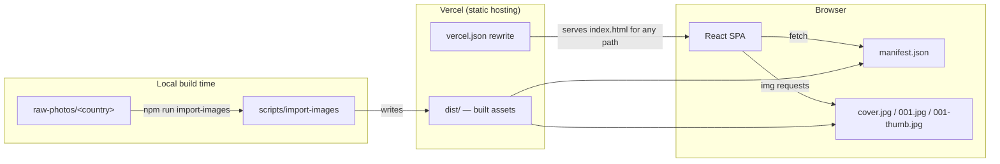
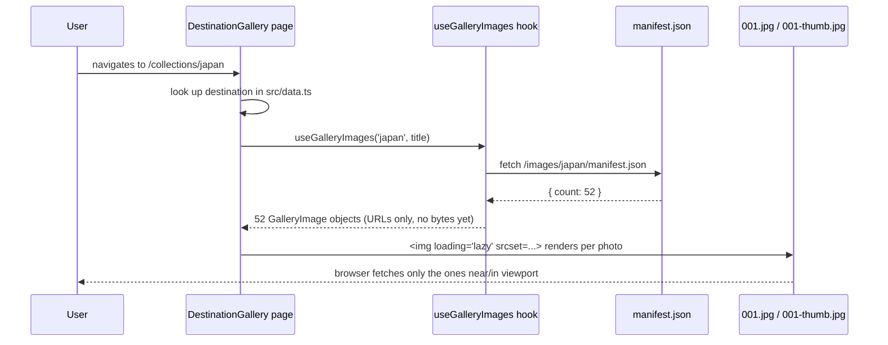
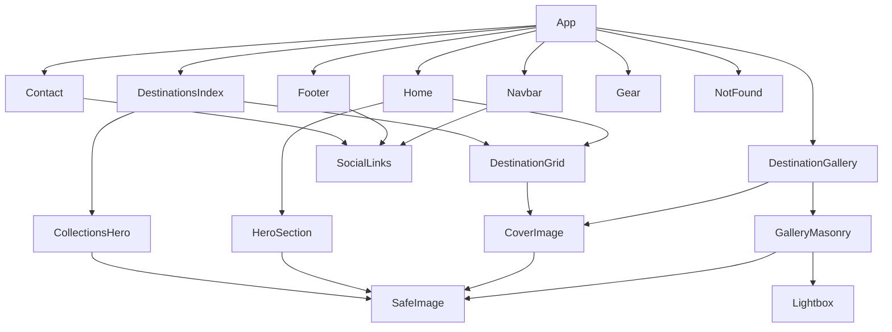

# Architecture

How the site is actually built, what runs where, and why.

## Table of Contents

- [System Overview](#system-overview)
- [Technology Stack](#technology-stack)
- [Why Vite, not Next.js](#why-vite-not-nextjs)
- [Rendering Model](#rendering-model)
- [Routing](#routing)
- [Data Flow](#data-flow)
- [Component Architecture](#component-architecture)
- [Build & Deployment](#build--deployment)

## System Overview

There is no backend, no database, and no API. The entire site is static files served from a CDN. The only "dynamic" behavior — auto-discovering how many photos are in a gallery — happens by fetching a tiny pre-generated `manifest.json`, not by querying anything live.

## Technology Stack

| Technology | Role | Why |
|---|---|---|
| **Vite** | Build tool + dev server | Near-instant HMR, trivial static output, no framework overhead for a site that doesn't need SSR/API routes. |
| **React 19** | UI library | Component model fits a page built from repeated units (destination cards, gallery photos, nav links). |
| **TypeScript** | Type safety | Catches mistakes in the data layer (`Destination`, `GalleryImage` shapes) and component props before they become runtime bugs. |
| **React Router v7** | Client-side routing | Standard, well-documented SPA routing; `BrowserRouter` + a rewrite rule at the host is all a static SPA needs. |
| **Tailwind CSS v4** | Styling | Utility-first matches this project's actual need — a small, consistent set of spacing/type/color tokens reused everywhere, not a component library to theme. |
| **Motion** (the `motion` package, formerly Framer Motion) | Animation | Declarative `initial`/`animate`/`whileInView` props keep motion co-located with the JSX it animates, and make "does this element animate" grep-able. |
| **Lucide** | Icons | Single consistent line-icon set (thin stroke) matching the editorial aesthetic — see [DESIGN.md](DESIGN.md). |
| **sharp** | Image processing (build-time only) | Runs inside `scripts/import-images/` — resizing, format conversion, EXIF-aware auto-rotation, and the stats (`sharpness`, `entropy`) the cover-scoring heuristic depends on. Never shipped to the browser. |
| **npm** | Package manager | What's actually in this repo (`package-lock.json`). If you're expecting `pnpm`, that's a documentation assumption from an earlier brief, not what's installed. |

## Why Vite, not Next.js

The original project brief referenced Next.js, and some earlier planning documents assumed it. The site that actually exists is a Vite-built single-page app. That turned out to be the right fit, not a compromise:

- The site has no server-side logic, no auth, no per-request personalization, no database. Everything a page needs is either bundled at build time or a static JSON/image file.
- Next.js's main advantages over a plain SPA — SSR, API routes, `next/image` on-demand optimization — all require a Node.js (or edge) runtime in production. This project deploys as pure static files, which is simpler to host, cache, and reason about.
- The one real cost of this choice: **no prerendering**, so link-preview crawlers that don't execute JavaScript (many chat apps, some social platforms) only ever see `index.html`'s static `<meta>` tags, not the per-page ones `useSEO` sets at runtime. Google's crawler does execute JS, so this doesn't hurt search indexing — just per-page social card previews. If that becomes a priority, the fix is prerendering (e.g. a static-generation pass), not switching frameworks.

## Rendering Model

Client-side rendering only (CSR). `src/main.tsx` mounts one React tree into `
`; from then on, everything — routing, data loading, meta tag updates — happens in the browser. There is no hydration step because there's no server-rendered HTML to hydrate.

## Routing

Defined in `src/App.tsx`:

| Path | Page | Notes |
|---|---|---|
| `/` | `Home` | Loaded eagerly (not code-split) — it's the most common entry point. |
| `/collections` | `DestinationsIndex` | Lazy-loaded. |
| `/collections/:id` | `DestinationGallery` | Lazy-loaded. Redirects to `/collections` if `:id` doesn't match a known destination. |
| `/gear` | `Gear` | Lazy-loaded. Currently a placeholder — see [GEAR_SYSTEM.md](GEAR_SYSTEM.md). |
| `/contact` | `Contact` | Lazy-loaded. |
| `*` (anything else) | `NotFound` | Lazy-loaded. Catch-all 404. |

Every route except `Home` is wrapped in `React.lazy` + one shared `<Suspense fallback={null}>`, so visiting `/` never pays the bytes for gallery/contact/404 code. `vite.config.ts` additionally splits vendor code (`react`, `react-dom`, `react-router-dom` in one chunk; `motion` in another) from app code, so the two change-frequency profiles cache independently.

## Data Flow

Two independent data sources, deliberately kept separate:

1. **Destination metadata** (`src/data.ts`) — hand-written, in the repo, part of the JS bundle. Title and description text for each country. Small and rarely changes.
2. **Photo inventory** (`public/images/<id>/manifest.json` + numbered files) — generated by the import pipeline, fetched at runtime. This is what lets you add hundreds of photos without touching any TypeScript.

The manifest fetch replaced an earlier design that probed for `001.jpg`, `002.jpg`, ... by trying to load each one — which meant downloading full-resolution images just to check they existed, on every page that showed a photo count (including the homepage). See [IMAGE_PIPELINE.md](IMAGE_PIPELINE.md) for the full story.

## Component Architecture

Rough dependency shape — pages compose components, components compose smaller components, nothing reaches sideways across the tree:

`SafeImage` is the one component nearly everything funnels through — see [STYLE_GUIDE.md](STYLE_GUIDE.md) for why, and why you should reach for it instead of a raw ``.

## Build & Deployment

- `npm run build` → `vite build` → static output in `dist/`.
- Deployed to **Vercel** as a static site. `vercel.json` pins the build command/output directory explicitly (rather than relying on auto-detection) and adds the one piece of config a client-routed SPA actually needs on static hosting: a rewrite so every path serves `index.html`, letting React Router take over instead of the host 404ing on a direct link to `/collections/japan`.
- No environment variables, no server functions, no database connection to configure.

Full deployment steps live in the root [README.md](../README.md#deployment).
