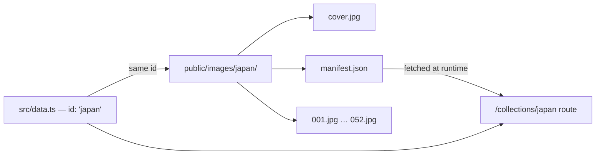

# Collections

How a "destination" works, end to end — the metadata layer, the photo layer, and how the two connect.

## Table of Contents

- [Current Collections](#current-collections)
- [Two Layers, One Connection](#two-layers-one-connection)
- [Adding a New Country](#adding-a-new-country)
- [Removing a Country](#removing-a-country)
- [A Note on Philippines](#a-note-on-philippines)

## Current Collections

| Country | `id` | Photos |
|---|---|---|
| Japan | `japan` | 52 |
| Taiwan | `taiwan` | 52 |
| Bali | `bali` | 25 |
| Thailand | `thailand` | 28 |

That's the full, current list — defined in `src/data.ts` and backed by real photos in `public/images/`.

## Two Layers, One Connection

A collection is the join of two independent pieces, deliberately kept apart so that neither one requires touching the other:

1. **Metadata** — `src/data.ts`. A hand-written `Record<string, Destination>` with `id`, `title`, `description`. This is the *only* place collection copy lives; it's part of the JS bundle and changes rarely.
2. **Photos** — `public/images/<id>/`. Generated by `npm run import-images` from `raw-photos/<id>/`. Cover image, numbered gallery photos, thumbnails, and a `manifest.json` the site reads to know the count. See [IMAGE_PIPELINE.md](IMAGE_PIPELINE.md) for the full mechanics.

The connection between them is exactly one string: the `id`. `DestinationGrid`, `DestinationGallery`, and the routing in `App.tsx` (`/collections/:id`) all key off of it. There's no third place that needs to know a country exists — no route table entry, no manual nav link, no hardcoded image list.



## Adding a New Country

1. `raw-photos/<id>/` — create the folder (lowercase, matching what you'll use as the `id`), drop in camera photos.
2. `src/data.ts` — add one entry:
   ```ts
   iceland: {
     id: 'iceland',
     title: 'Iceland',
     description: '...',
   },
   ```
3. `npm run import-images -- iceland`
4. Add `/collections/iceland` to `public/sitemap.xml`.

The homepage grid, `/collections`, and the gallery page all pick it up automatically — nothing else references the destination list.

## Removing a Country

The reverse of adding one: delete the entry from `src/data.ts`, delete `public/images/<id>/`, remove its URL from `sitemap.xml`. If it's referenced anywhere in hero tagline copy (e.g. `HeroSection.tsx`'s "JAPAN • TAIWAN • BALI • THAILAND" line), update that text too — that line is hand-written, not derived from `data.ts`.

## A Note on Philippines

An earlier version of this project included a Philippines collection. It was intentionally removed (not lost, not a bug) at the owner's request when the site didn't yet have real photos ready for it. Re-adding it later is exactly the ["Adding a New Country"](#adding-a-new-country) flow above — there's nothing special about it structurally, it's just not currently populated. If you're reading this because you expected to see it: that's the explanation, and reviving it is a five-minute task whenever real Philippines photos are ready.
