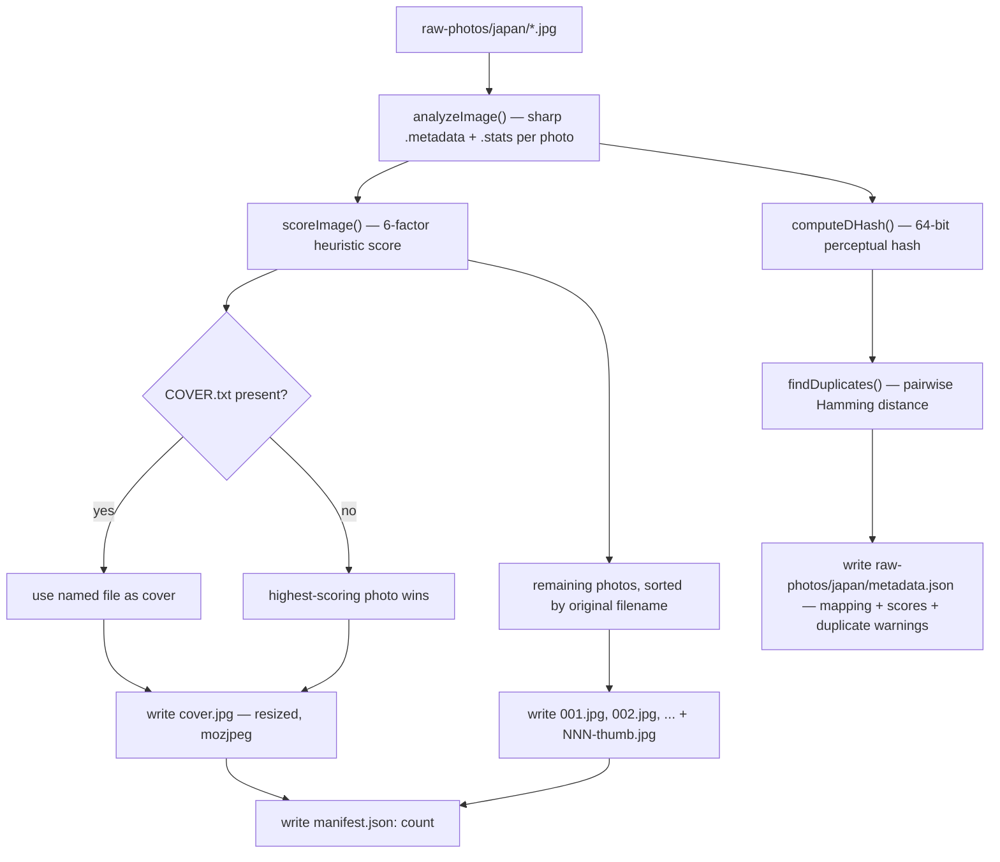

# Image Pipeline

How photos get from a camera SD card to the live site, with nothing renamed by hand.

## Table of Contents

- [The Problem This Solves](#the-problem-this-solves)
- [Folder Contract](#folder-contract)
- [Pipeline Walkthrough](#pipeline-walkthrough)
- [Cover Selection Algorithm](#cover-selection-algorithm)
- [Duplicate Detection](#duplicate-detection)
- [Thumbnails](#thumbnails)
- [How the Site Consumes the Output](#how-the-site-consumes-the-output)
- [Extending the Scorer with AI Vision](#extending-the-scorer-with-ai-vision)

## The Problem This Solves

Camera and phone exports look like `IMG_3847.JPG`, `DSC01234.JPG`, `PXL_20250812.jpg` — never numbered sequentially, never pre-picked for a "best" cover shot, and mixed file extensions. The site, meanwhile, expects a predictable shape per destination:

```
public/images/<country>/
├── cover.jpg
├── 001.jpg, 002.jpg, ...
└── 001-thumb.jpg, 002-thumb.jpg, ...
```

`scripts/import-images/` bridges the two without any manual renaming, and without a `gallery/` subfolder — everything for a country lives flat in one directory (see [PROJECT_STRUCTURE.md](PROJECT_STRUCTURE.md) for why that layout, specifically).

## Folder Contract

| Folder | Tracked in git? | Purpose |
|---|---|---|
| `raw-photos/<country>/` | **No** (gitignored) | Drop zone. Any filenames, any of `.jpg` `.jpeg` `.png` `.webp`. This is where you put camera exports. |
| `public/images/<country>/` | Yes | Pipeline output. What the deployed site actually serves. Never hand-edit files here — they get overwritten on the next run. |

Three optional files change pipeline behavior, both live in `raw-photos/<country>/`:

- **`COVER.txt`** — plain text file containing the exact original filename to force as the cover, bypassing auto-selection.
- **`CARD.txt`** — same format; writes that photo as `card.jpg` for the portrait homepage/collections cards, so a wide shot can stay the banner cover. The photo also stays in the gallery. Set `hasCardImage: true` on the destination in `src/data.ts` to use it.
- **`metadata.json`** — written *by* the pipeline (not an input), documented below.

## Pipeline Walkthrough



Run it with:

```bash
npm run import-images              # every folder under raw-photos/
npm run import-images -- japan     # just one (or space-separate several)
```

Each run for a country:

1. Reads every accepted file in `raw-photos/<country>/`.
2. Runs `sharp().rotate().metadata()` and `.stats()` on each — `.rotate()` with no arguments auto-orients based on EXIF and strips the orientation tag, so a photo shot in portrait doesn't come out sideways.
3. Scores every photo (see below) and computes a perceptual hash for duplicate detection.
4. Picks the cover — either the `COVER.txt` override or the highest total score.
5. Clears any previously-generated `cover.jpg` / `NNN.jpg` / `NNN-thumb.jpg` from `public/images/<country>/` (targeted deletion by filename pattern — never a recursive wipe of the folder, so anything else you might have placed there is untouched).
6. Writes the new `cover.jpg`, numbered gallery files, and thumbnails — all re-encoded to JPEG (`mozjpeg: true`) regardless of source format, auto-rotated, and capped at a max dimension (never upscaled).
7. Writes `manifest.json` into the *public* output folder and `metadata.json` into the *raw* source folder — deliberately split, see [How the Site Consumes the Output](#how-the-site-consumes-the-output).

| Output | Max long edge | JPEG quality | Used for |
|---|---|---|---|
| `cover.jpg` | 2600px | 90 | Homepage/collections cards, gallery page hero banner, Collections hero |
| `card.jpg` (optional) | 2600px | 90 | Homepage/collections cards instead of `cover.jpg`, when `CARD.txt` is set |
| `NNN.jpg` | 2400px | 88 | Lightbox full view |
| `NNN-thumb.jpg` | 900px | 82 | Masonry grid (via `srcset`) |

## Cover Selection Algorithm

`scripts/import-images/scoring.mjs` scores every candidate 0–1 on six factors, each backed by a metric `sharp().stats()` already computes (no hand-rolled image analysis):

| Factor | Weight | Signal |
|---|---|---|
| Sharpness | 0.30 | libvips' edge/focus strength — the single strongest signal for "is this photo in focus." |
| Exposure | 0.20 | How close mean luminance is to mid-tone; penalizes crushed blacks and blown highlights. |
| Vibrance | 0.15 | Average per-channel standard deviation — a contrast/color-variance proxy. Flat, washed-out frames score low. |
| Resolution | 0.15 | Megapixels, with diminishing returns past ~12MP (a bigger file isn't automatically a better cover). |
| Entropy | 0.10 | Shannon entropy of the greyscale histogram — how much *information* is in the frame. An empty sky scores low; a busy street scene scores high. |
| Aspect ratio | 0.10 | Rewards ratios that work for both a wide hero banner and a portrait grid card; penalizes extreme panoramas/strips. |

The weights live in one exported constant (`WEIGHTS`) and are meant to be tuned — if covers keep coming out soft, raise `sharpness`; if low-res phone shots keep winning, raise `resolution`.

This is explicitly a **heuristic**, not an aesthetic judgment. It reliably filters out blurry, dark, empty, or awkwardly-cropped shots, but it doesn't understand composition, subject, or emotional weight the way a person (or a vision model) does. That's a deliberate scope boundary — see [Extending the Scorer with AI Vision](#extending-the-scorer-with-ai-vision).

## Duplicate Detection

`scripts/import-images/hash.mjs` computes a difference-hash (dHash) per photo: downscale to 9×8 greyscale, compare each pixel to its right neighbor, pack the 64 comparisons into a `BigInt`. Any two photos with a Hamming distance ≤ 6 (out of 64 bits) get flagged as likely duplicates/near-duplicates (burst shots, accidental double-taps).

Flagged pairs are **warned about, never auto-deleted** — they show up in the console output and in `metadata.json`'s `duplicateWarnings` array. Both photos still get numbered normally. Deciding which one to keep is a judgment call left to a human.

## Thumbnails

Masonry grid cells never render wider than ~⅓ of the viewport, so serving the same 2400px file used by the lightbox to a grid thumbnail wastes bandwidth for no visible benefit. Every gallery photo gets a second, smaller `-thumb.jpg` sibling; the site wires both into one `` via `srcset`/`sizes` so the browser picks the right one for its layout and pixel density.

## How the Site Consumes the Output

`src/lib/gallery.ts` fetches `public/images/<id>/manifest.json` — a one-line JSON file (`{ "count": 52 }`) — instead of probing for `001.jpg`, `002.jpg`, etc. by trying to load each one. That earlier probing approach meant checking existence by actually downloading full images, which meant every page that displayed a photo count (including the homepage grid) was silently downloading every photo in every gallery. See [ARCHITECTURE.md](ARCHITECTURE.md#data-flow) for the full before/after.

If `manifest.json` is missing — e.g. numbered files were dropped in by hand instead of through the pipeline — `gallery.ts` falls back to lightweight `HEAD` requests (headers only, no image bytes) up to a ceiling of 60 photos, so the "just drop numbered files in and it works" promise still holds without the pipeline.

`metadata.json`, by contrast, is written to `raw-photos/<id>/` — never shipped to the deployed site. It's a local reference file: original filename → new filename, each photo's score breakdown, and duplicate warnings. Useful for tracing a published photo back to its source file; not something the browser ever needs.

## Extending the Scorer with AI Vision

`scoreImage()` has a deliberately fixed signature:

```js
async function scoreImage({ width, height, stats }) → { total, breakdown }
```

A vision-model-based scorer with the same return shape — say `scoreImageWithVisionModel(filePath) → { total, breakdown }` — can be swapped in without touching `run.mjs`, `hash.mjs`, or anything downstream. This was designed in from the start specifically so "upgrade cover selection to understand composition/subject" is a self-contained, low-risk change later. See [ROADMAP.md](ROADMAP.md).
